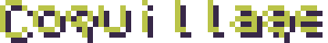

<p align="center">
  
</p>

<p align="center">
  
  
  
  
  
</p>

<p align="center">
  Bosque a vista de pájaro. Render propio. Sin motor.
</p>

Caminas un claro: agua, troncos, copas que se abren solo cuando pasas debajo. El sol mueve la luz de las hojas. De noche entra la luna. Una llama cerca del claro tira a naranja.

## Jugar

Rust 1.96 y un linker de C. En Windows, MinGW (w64devkit) en el `PATH`, y el toolchain gnu que ya usa esta máquina.

```powershell
cargo run --release
```

La ventana se llama **Coquillage — Phase 8**, a 1280×720. El título muestra los FPS.

| Tecla | Hace |
| --- | --- |
| W A S D o flechas | Caminar |
| Q / E | Saltar una hora |
| R | Lluvia |
| Escape | Salir |

## Qué mirar

- Figura chica desde arriba. Cabeza arena, camisa azul, manos de cuatro píxeles.
- El agua y los troncos frenan. La hierba no.
- Bajo una copa, solo esa copa se transparenta.
- Q y E mueven la mancha clara de las hojas. La llama del claro no cambia de color con la hora.

Los sprites salen de `tools/gen_props.py` y `tools/gen_tiles.py`.
